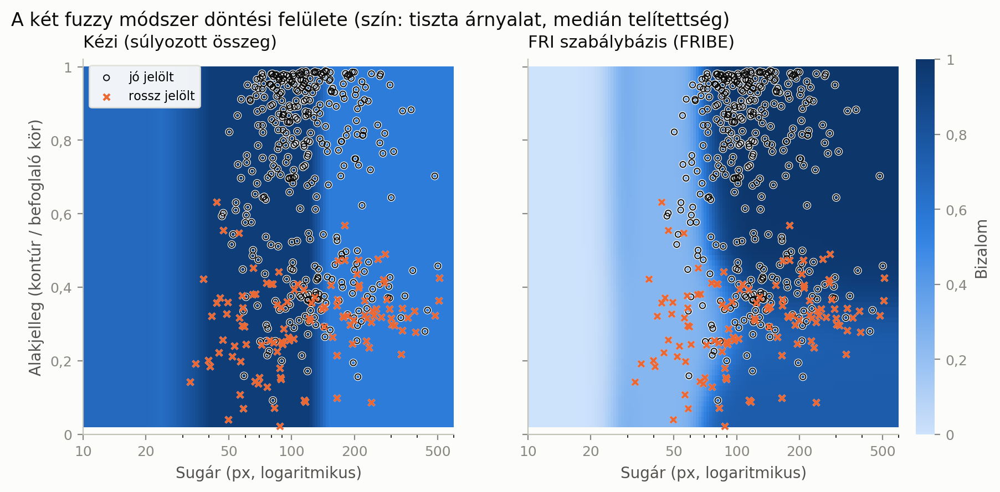
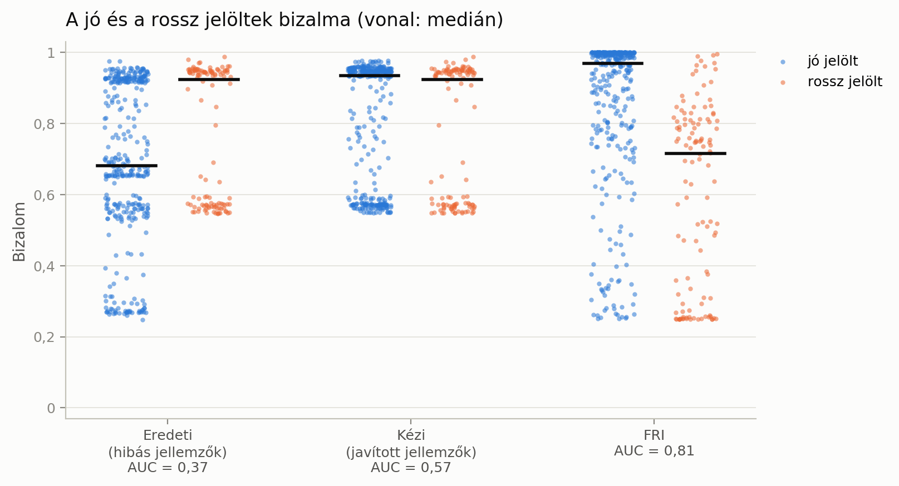

# Fuzzy bizalomszámítás: kézi függvények és FRI szabálybázis (szimuláció)

## Mi változott a kontúr alapú detektorban

1. **A színjellemzők javítása** (mindkét módszert érinti):
   - A színátlag eddig a kitöltött kontúr összes pixeléből számolódott, így **a karika lyukán át látszó szürke háttér is beleszámított**. Egy teljesen látható kék karikánál ez 38 egységnyi árnyalat-eltérést okozott (82 a 120 helyett), a zöldnél 20-at. Most csak a karika színes pixelei számítanak.
   - Az árnyalat átlaga **körkörös átlag** lett. A piros a 0 és a 179 körül is előfordul, ezek sima átlaga 90 körüli, tehát cián lenne.
   - A teljes kép HSV-átalakítása képkockánként egyszer történik meg, nem kontúronként.
2. **Új bemenet: alakjelleg** (`circularity` = kontúr területe / befoglaló kör területe). Egy teljes karika 1 közeli értéket ad, a képszél által levágott ív vagy egy letört darab sokkal kevesebbet.
3. **A bizalmat az egyetem fuzzy szabályinterpolációs motorja számolja** (FRIBE, Piller Imre: [fribe-python](https://github.com/piller-imre/fribe-python)), egy FBDL nyelven írt szabálybázis alapján: [`donut_confidence.fbdl`](../../drone_ws/src/tello_camera/rules/donut_confidence.fbdl).
   - Az eredeti kézi függvények `-p fuzzy_method:=manual` paraméterrel továbbra is elérhetők.
   - Saját szabályfájl a `-p rules_file:=...` paraméterrel adható meg.

## Hogyan számol az FRIBE

- **Skálázó függvény:** minden bemenetnek (universe) van egy szakaszonként lineáris skálázó függvénye. Ezt a `"név" középpont érték` sorok adják meg, és ez mondja meg, mennyire „számít” egy adott különbség. Az `x` és a szabály `a` pontja közötti távolság egy dimenzióban:

      δ = |s(x) − s(a)| / (s_max − s_min)

- **Szabálytávolság:** a dimenzióbeli távolságok négyzetének átlaga:

      d_i = (1/n) · Σ δ_k²

- **Következtetés:** Shepard-interpoláció a szabályok következményei (`b_i`) között:

      y = Σ w_i · b_i / Σ w_i,   w_i = 1 / d_i²

  Ha egy szabály pontosan illeszkedik (`d_i = 0`), akkor az ő következménye adja a kimenetet.

Ezért elég néhány szabály: a köztes esetekre a motor a szabályok között interpolál.

## A szabálybázis

**Bemenetek:**
- sugár (px), logaritmikus jellegű skálázással;
- alakjelleg;
- árnyalat-eltérés a várt színtől;
- telítettség.

**Kimenet:** bizalom (0–1).

| Ha… | akkor a bizalom |
|---|---|
| a sugár ideális vagy nagy, a kontúr teljes kör, a szín tiszta és telített | biztos (1) |
| a sugár ideális vagy nagy, de a kontúr csak ív, a szín tiszta és telített | magas (0,75) |
| a sugár kicsi | alacsony (0,25) |
| a sugár apró **vagy** a szín rossz **vagy** a szín fakó | nincs (0) |

A világosságot (V) nem használja. A színmaszk már kiszűri a sötét pixeleket, és a kézi változatban is csak kb. 7% volt a súlya.

## A mérés

- **Adathalmaz:** 300 kép a szimulációból, véletlenszerű drónpozíciókból.
  - 199 kép karikára célzott, 1,5–12 m távolságból, ±55°-os oldalszögből és a karika mindkét oldaláról.
  - 101 kép teljesen véletlen pozícióból és irányból.
  - Minden képhez ismert a drón pontos helyzete.
- **„Igazság” (ground truth):** a karikák középpontját és sugarát a kamera paramétereiből (960×720 px, 0,96 rad látószög, a kamera 3,5 cm-re a drón középpontja előtt) számoltuk vissza a képre. Képekre rajzolva ellenőriztük, hogy pontosan illeszkedik.
- **Jó jelölt:** a kontúr középpontja a valódi középponttól legfeljebb max(15 px; a karika sugarának 25%-a) távolságra van.
- **Jelöltek:** 476 kontúr, ebből 358 jó. Ugyanazokat a kontúrokat értékeltük ki mindhárom módszerrel, a kigyűjtés pontosan megegyezik a detektor saját `detect()` függvényével.
- **Tanító és teszthalmaz:** a szabálybázist csak az első 150 képen hangoltuk (öt változatból a legegyszerűbb, legjobb lett a végleges). Az eredményt a hangolásnál nem használt második 150 képen mérjük.

Mért jellemzők:
- **Helyes választás:** az adott színű jelöltek közül a legnagyobb bizalmú jó-e. Ezt a detektor továbbítja a missionnek.
- **Többjelöltes eset:** ugyanez csak azokra a képekre, ahol egy színből több kontúr is van. Jellemzően a karika árnyékos része kiesik a színmaszkból, és két ívre esik szét.
- **AUC:** mennyire választja szét a bizalom a jó és a rossz jelölteket. Annak a valószínűsége, hogy egy véletlen jó jelölt nagyobb bizalmat kap, mint egy véletlen rossz. 1 = tökéletes, 0,5 = véletlen.

## Eredmények

### Teszthalmaz (a hangolásnál nem használt 150 kép, 244 jelölt)

| Módszer | Helyes választás | Többjelöltes eset | AUC |
|---|---|---|---|
| Eredeti (hibás színjellemzők, kézi függvények) | 170/174 | 8/12 | 0,35 |
| Kézi függvények, javított jellemzőkkel | 171/174 | 9/12 | 0,54 |
| **FRI szabálybázis** | **174/174** | **12/12** | **0,79** |

### Teljes adathalmaz (300 kép, 476 jelölt)

| Módszer | Helyes választás | Többjelöltes eset | AUC |
|---|---|---|---|
| Eredeti | 352/358 | 11/17 | 0,37 |
| Kézi, javított jellemzőkkel | 354/358 | 13/17 | 0,57 |
| **FRI** | **358/358** | **17/17** | **0,81** |

### Futásidő (egy processzormagon)

| Módszer | Egy jelölt bizalma | Egy kép teljes feldolgozása |
|---|---|---|
| Kézi | ~3 µs | 9,5 ms |
| FRI | ~190 µs | 9,8–11,2 ms |

Az FRI kb. 1 ms-mal (≈10%-kal) lassítja a képfeldolgozást. Ez így is több mint háromszor gyorsabb, mint a kamera képfrissítése (30 kép/s = 33 ms).

### Teljes misszió (szimuláció, a két módszer párban, azonos terhelés mellett)

| Módszer | n | Sikeres | Misszió hossza (lépés) | Keresés (lépés) | RMS hiba yaw közelítéskor (px) |
|---|---|---|---|---|---|
| Kézi (javított jellemzőkkel) | 3 | 3/3 | 606 ± 15 | 81 ± 1 | 16,2 ± 0,9 |
| FRI | 3 | 3/3 | 579 ± 18 | 72 ± 30 | 15,4 ± 0,6 |

Mindkét módszerrel minden misszió sikeres volt. Az FRI-s futások valamivel rövidebbek voltak, de 3-3 futásból ez a szórás nagysága miatt nem tekinthető biztos különbségnek. A misszió szempontjából tehát az FRI legalább olyan jó, mint a kézi módszer. A nyers naplók a `raw/missions` mappában vannak.

## Következtetések

1. **A legnagyobb hiba a jellemzők számításában volt, nem a fuzzy logikában.** A lyukon átlátszó háttér miatt a kézi módszer a teljesen látható karikákat pontozta le. Az AUC 0,5 alatti, tehát a bizalom rosszabb volt a véletlennél.
2. **A szimulációban a színjellemzők nem különböztetnek meg semmit**, mert a renderelt színek tiszták. A jó és rossz jelöltek közötti különbséget a **méret és az alak** hordozza. A kézi módszer az alakot nem ismeri, az FRI szabálybázis igen.
3. **Az FRI szabálybázis minden esetben a jó jelöltet választotta** (a teszthalmazon 174/174, a többjelöltes esetekben 12/12), és a bizalmi érték is sokkal jobban jelzi, mennyire megbízható a jelölt (AUC 0,79 a 0,54-dal szemben).
4. **A szabálybázis olvasható és bővíthető:** 8 szabály, amit a dolgozatban szövegesen is be lehet mutatni, és a kód módosítása nélkül lehet hangolni.
5. **A mission jelenleg nem használja a bizalmi értéket**, csak a kiválasztott jelölt helyét. A jobb bizalom ezért a misszióban főleg a többjelöltes eseteknél (rossz ív helyett a jó ív) számít. Továbbfejlesztési lehetőség, hogy a mission a kis bizalmú (ív alakú) jelöltnél óvatosabban közelítsen.

## Újrafuttatás

A detektor alapból az FRI-t használja. Az eredeti kézi változat:

    ros2 run tello_camera tello_camera_contour --ros-args -p image_topic:=/topic_ns/image_raw -p fuzzy_method:=manual

A grafikonok újrarajzolása a konténerben (ott van matplotlib és fribe):

    python3 results/fuzzy/scripts/plots.py results/fuzzy/candidates.json drone_ws/src/tello_camera/rules/donut_confidence.fbdl results/fuzzy

A mérés scriptjei a [`scripts`](scripts) mappában vannak:
- `capture.py`: képek gyűjtése véletlen pozíciókból;
- `gt.py`: a valódi karikahelyzetek visszavetítése;
- `extract.py`: a jelöltek kigyűjtése;
- `evaluate.py`: a módszerek összehasonlítása;
- `mission_stats.py`: a missziók összesítése;
- `plots.py`: a grafikonok.

A [`candidates.json`](candidates.json) tartalmazza mind a 476 jelöltet:
- a régi és az új jellemzőket;
- a valódi karikahelyzetet és a középpont hibáját;
- mindegyik kép valódi karikahelyzeteit.

A képek nincsenek a repóban, mert 250 MB-ot foglalnak.

## Licenc

- **fribe-python:** GPL-3.0. A Docker image építésekor rögzített verzióval töltődik le, a repó nem tartalmazza.
- **exprail-python:** MIT.
