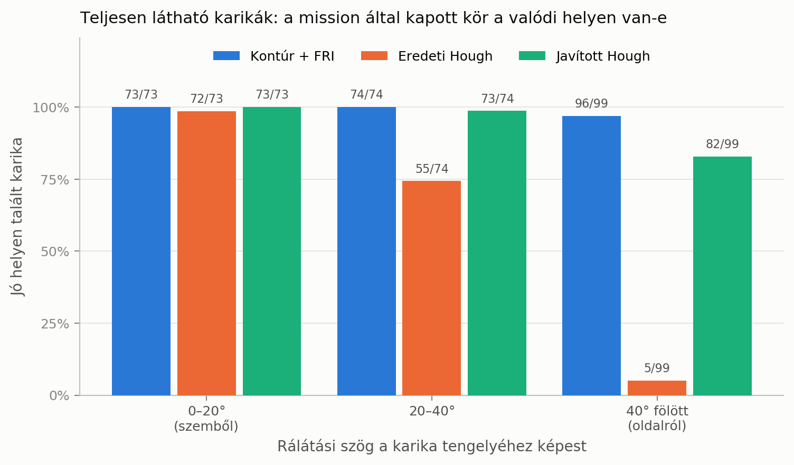
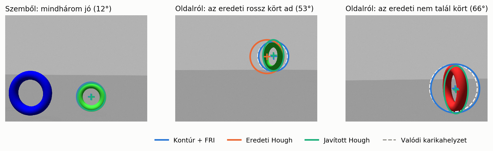

# Hough körkereső: átnézés, javítás és összehasonlítás a kontúr alapú detektorral

A fájl első fele az **eredeti** Hough-detektor átnézése és mérése; ez ma a `-p method:=original` paraméterrel érhető el. A **javított** változat (az alapértelmezés) leírása és mérése lent, [A javított Hough](#a-javított-hough) résznél van.

## Hogyan működik az eredeti `tello_camera_hough`

1. A képet szürkeárnyalatossá alakítja, és mediánszűrővel (5×5) zajt csökkent. A `resize` szorzója 1, tehát valójában nem kicsinyít.
2. `cv2.HoughCircles` (HOUGH_GRADIENT) a következő beállításokkal:
   - `dp=1.2`;
   - `minDist=50` px (két kör középpontja legalább ennyire van egymástól);
   - `param1=100` (az élkereső felső küszöbe);
   - `param2=40` (ennyi „szavazat” kell egy körhöz);
   - sugár 20–300 px.
3. **Színhozzárendelés:** minden talált kör mentén egy 0,3·r vastag gyűrűben megszámolja, mennyi pixel esik az egyes színmaszkokba, és a legnagyobb arányú szín lesz a kör színe.
4. **„Fuzzy” rész:**
   - jelenlét = talált körök száma / 3;
   - aktiváció = min(jelenlét, legjobb színarány), ami fuzzy ÉS művelet;
   - aktív, ha az aktiváció ≥ 0,25.
5. **Kimenet:** minden talált kört kiküld a `donut_detector/circles` topicra (x, y, r, szín, arány), ugyanabban a formában, mint a kontúr alapú. A mission ezek közül a célszínű, 20–500 px sugarú körök közül a legnagyobbat választja.

A két detektor tehát cserélhető: a mission mindkettővel működik, ugyanazokat a topicokat használják.

## Átnézés: mi működik és mi nem

| # | Megállapítás | Hatás |
|---|---|---|
| 1 | **A Hough csak kört keres.** Oldalról nézve a karika ellipszis, ilyenkor nem talál kört, vagy egy rosszat illeszt rá. | Nagy: 40° fölötti rálátásnál a karikák 7%-át találja meg jó helyen (lásd lent). |
| 2 | **A színt küszöb nélkül rendeli a körhöz.** Egy álkör, ami a karikának csak 19%-át fedi, ugyanúgy megkapja a karika színét. A mission a legnagyobbat választja, és ez gyakran az álkör. | Nagy: a teljesen látható karikák 27%-ánál rossz helyre kormányozná a drónt. |
| 3 | **A színmérő gyűrű nem illik a karika alakjához.** A 0,3·r vastag sáv a kör vonalára van rajzolva, a karika viszont a külső sugár 60%-a és 100%-a között van. A sáv fele így a háttérre esik, a jó karikák színaránya is csak 0,47 (medián). | Közepes: emiatt nehéz értelmes küszöböt adni a 2. ponthoz. |
| 4 | **A legnagyobb keresett sugár 300 px, a mission viszont épp 300 px-nél kezdi az átrepülést.** Az átrepülés így többnyire a „célt elvesztette, de közel volt” ágon indul. | Kicsi: működik, de esetlegesebb. |
| 5 | **A képből kilógó karikát nem találja meg**, mert a kör középpontjának a képen belül kell lennie. | Közepes: a képszélen levágott karikák fele kimarad (107/220). |
| 6 | **Minden talált kört kiküld, színenként nem választ.** A „jelenlét” az álkörökkel együtt számol. | Kicsi |
| 7 | **A megjelenítés kijelző nélkül az egész node-ot leállítja** (Qt `Aborted`, a `try` sem segít). Ez a kontúr alapúra is igaz, ha `visualize:=true`. | Kicsi (nálad mindig van kijelző) |
| 8 | Az `info` topicra Python-szótár szöveg megy, nem JSON. A HSV-átalakítás körönként újra lefut. A `resize` nem csinál semmit. | Apróság |

## Összehasonlító mérés

**Adathalmaz:** ugyanaz a 300 kép véletlen drónpozíciókból, ismert karikahelyzetekkel, mint a fuzzy mérésnél.

**Értékelés:** úgy mérjük, ahogy a mission használja a detektort: az adott színű, 20–500 px sugarú körök közül a legnagyobb. Ez akkor „jó helyen” van, ha a középpontja legfeljebb max(15 px; a karika sugarának 25%-a) távolságra van a valóditól.

### Felismerés a karika láthatósága szerint (képenként és színenként)

| Láthatóság | Kontúr + FRI | Hough |
|---|---|---|
| Teljesen látszik (246) | **243 jó**, 3 rossz helyen | 137 jó, 66 rossz helyen, 43 kimaradt |
| Részben, képszélen (220) | 114 jó, 91 rossz helyen, 15 kimaradt | 81 jó, 32 rossz helyen, 107 kimaradt |
| Nem látszik (434) | 3 téves találat | 0 téves találat |

- Részben látható karikánál mindkét módszer gyakran téved a középponttal, mert csak egy ív látszik.
- A kontúr alapú ilyenkor is ad egy irányt, és az ív felé fordulva a karika hamar teljesen látható lesz.
- A Hough ilyenkor inkább semmit nem lát, és a drón keresésbe kezd.

### A rálátási szög a döntő tényező

| Rálátás a karika tengelyéhez | Kontúr + FRI | Hough |
|---|---|---|
| 0–20° (szemből) | 73/73 | 71/73 |
| 20–40° | 74/74 | 59/74 |
| 40° fölött (oldalról) | 96/99 | **7/99** |

### Futásidő (egy kép, egy processzormag)

| Kontúr + FRI | Hough |
|---|---|
| 10,3 ms | 16,5 ms |

### Teljes misszió (szimuláció, párban, azonos terhelés mellett)

| Detektor | n | Sikeres | Misszió hossza (lépés) | Ebből keresés (lépés) | Valós idő | RMS hiba yaw közelítéskor (px) | Átrepülés indítása |
|---|---|---|---|---|---|---|---|
| Kontúr + FRI | 3 | 3/3 | 600 ± 18 | 71 ± 28 | 50–60 s | 16,0 ± 1,4 | 9/9 „elég közel” (r ≥ 300 px) |
| Hough | 3 | 3/3 | 4281 ± 2425 | 3444 ± 2039 | 110–286 s | 31,4 ± 0,7 | 9/9 „elvesztette, de közel volt” |

- **A Hough-gal is végigért mindhárom misszió, de átlagosan hétszer annyi lépésből**, és a lépések 80%-a keresés volt. A piros és a zöld karikát a drón az első után oldalról közelíti meg, és ilyenkor a Hough nem látja.
- **Közelítéskor a vízszintes hiba kétszer akkora** (31 px a 16 helyett), mert a Hough-kör középpontja kevésbé pontos.
- **Az átrepülés minden esetben a tartalék ágon indult**, mert a Hough legfeljebb 300 px-es kört keres, így a mission 300 px-es „elég közel” feltétele nem teljesült. Ez az átnézés 4. pontját igazolja.

A nyers naplók a `raw/missions` mappában vannak.

## Következtetés a dolgozathoz

- **A Hough-módszer működőképes alternatíva, de csak szemből.** A karikák kör alakját közvetlenül keresi, a színtől függetlenül, és szemből (0–20°) a karikák 97%-át jó helyen találja.
- **Oldalról nézve viszont használhatatlan:** a karika ellipszisnek látszik, a kör-transzformáció pedig erre nem illeszkedik. 40° fölött a karikák 7%-át találja meg.
- **A kontúr alapú detektor a szögtől szinte független** (96–100%), és gyorsabb is (10,3 ms a 16,5 ms-mal szemben). Ezért lett a rendszer fő detektora.
- **A dolgozat régi szövege ezzel ellentétes:** „éles szögben … a kontúr detektor pedig csak elveszti a kört”. A mérésben 85°-ig (szinte élről) is voltak teljesen látható karikák, és a javított kontúr alapú detektor ezek közül összesen háromszor tévedett (52°, 64° és 72°-nál). Hogy a régi megfigyelés honnan jött (a régi, hibás színszámításból vagy más helyzetből), az a mérésből nem derül ki.

## A javított Hough

Az átnézés megállapításai alapján a detektort átdolgoztam (2026. 11. 24.). Ez lett az alapértelmezés, az eredeti a `-p method:=original` paraméterrel érhető el.

### Mi változott

| Átnézési pont | Javítás |
|---|---|
| 1. Csak kört keres, oldalról a karika ellipszis | **Vízszintes nyújtás.** A karikák függőlegesek, és a drón nem dől oldalra, ezért oldalról a karika függőleges tengelyű ellipszis, aminek a szélessége a magasság cos θ-szorosa. A maszkot vízszintesen 1×, 1,5×, 2× és 3×-ra nyújtva valamelyiknél kör lesz, és ezt a kör-Hough megtalálja (kb. 70°-ig). A kimenet sugara az ellipszis függőleges féltengelye, vagyis a karika valódi mérete. |
| 2. A színt küszöb nélkül rendeli a körhöz | **A Hough színenként, a színmaszkon fut**, a kontúr alapúval azonos HSV-tartományokkal. Így a szín eleve adott, és a háttér élei nem zavarnak. Egy kör csak akkor megy tovább, ha a karikasáv legalább 40%-a színes. |
| 3. A színmérő sáv nem illik a karikához | A sáv a karika alakját követi: a külső sugár 62–96%-a. |
| 4. A képből kilógó karikát nem találja | A maszk köré üres keret kerül (a kép szélességének 20%-a), így a képen kívüli középpontú kör is megtalálható. |
| 5. A legnagyobb sugár 300 px | A legnagyobb sugár 500 px, így közelről a misszió rendes, „elég közel” ága indul. |
| 6. Minden kört kiküld | Színenként csak a legjobb kör megy ki. |
| 8. Szöveges info, a `resize` nem csinál semmit | Az info JSON, a kicsinyítés valódi (0,4×). |
| – | **A sugár a karika külső széle.** A Hough a karika belső vagy külső élére is ráállhat. A középpont körüli radiális profilból (a kör mekkora része színes a sugár függvényében) mindig a külső szél adódik. |
| – | **Rövid kiesések áthidalása.** Ha egy szín egy képen nem látszik, az utolsó kör még legfeljebb 3 képen át változatlanul kimegy. A misszió a változatlan kört régi képnek veszi, és vár: nem kezd keresni, és nem indítja a tartalék átrepülést. |
| – | **Sebesség.** A kép 0,4×-esre kicsinyítve, az üres maszk kimarad, a Hough csak a színes pixelek környékén fut, és a node mindig a legújabb képet dolgozza fel (1-es sor). |

A kijelző nélküli `cv2.imshow` (7. pont) változatlan: kijelző nélkül `visualize:=false` kell.

**Paraméterek** (`--ros-args -p név:=érték`):

| Paraméter | Alapérték | Jelentés |
|---|---|---|
| `method` | `improved` | `original`: az eredeti, szürkeárnyalatos Hough |
| `scale` | 0.4 | a kép kicsinyítése a feldolgozás előtt |
| `param2` | 25 | a Hough szavazati küszöbe (a kicsinyített maszkon) |
| `min_fraction` | 0.4 | a karikasáv legalább ekkora része legyen színes |
| `stretches` | [1.0, 1.5, 2.0, 3.0] | a vízszintes nyújtások |
| `max_radius` | 500 | a legnagyobb sugár (px) |
| `hold_frames` | 3 | ennyi képen át megy még ki az utolsó kör, ha a karika eltűnt |

### Hangolás

A beállításokat az adathalmaz első 150 képén választottam ki. Ezeket a változatokat próbáltam:
- a maszk elmosása;
- a `dp` és a `param2`;
- a keret;
- a nyújtások halmaza;
- a színarány-küszöb;
- a kicsinyítés;
- az, hogy a nyújtások csak akkor fussanak-e, ha szemből nem volt jó kör.

Ez az utolsó gyorsabb lett volna, de oldalról rosszabb, ezért kimaradt.

**Teljesen látható karikák** (jó / rossz helyen / kimaradt):

| Halmaz | Kontúr + FRI | Eredeti Hough | Javított Hough |
|---|---|---|---|
| Tanító (első 150 kép, 118 karika) | 117 / 1 / 0 | 81 / 25 / 12 | 112 / 1 / 5 |
| Teszt (második 150 kép, 128 karika) | 126 / 2 / 0 | 51 / 49 / 28 | 116 / 4 / 8 |

A teszthalmazon is megmaradt az eredmény, tehát nem a tanító képekre hangolódott.

### Mérés az adathalmazon

**Az adathalmaz:** ugyanaz a 300 póz, mint fent. A képeket újra kellett gyártani, mert az előzők elvesztek; ugyanazzal a scripttel és véletlenmaggal készültek.
- **Kontúr alapú:** az eredménye pontosan ugyanaz, mint az első felvételen.
- **Eredeti Hough:** kicsit eltér (132 / 74 / 40 a 137 / 66 / 43 helyett), mert a kamera zaja felvételenként más, és a szürkeárnyalatos Hough erre is érzékeny.

A három detektor ugyanazokon a képeken:

| Láthatóság | Kontúr + FRI | Eredeti Hough | Javított Hough |
|---|---|---|---|
| Teljesen látszik (246) | 243 jó, 3 rossz helyen | 132 jó, 74 rossz helyen, 40 kimaradt | **228 jó, 5 rossz helyen, 13 kimaradt** |
| Részben, képszélen (220) | 114 jó, 91 rossz helyen, 15 kimaradt | 86 jó, 27 rossz helyen, 107 kimaradt | 116 jó, 13 rossz helyen, 91 kimaradt |
| Nem látszik (434) | 3 téves találat | 0 téves találat | 0 téves találat |

| Rálátás a karika tengelyéhez | Kontúr + FRI | Eredeti Hough | Javított Hough |
|---|---|---|---|
| 0–20° (szemből) | 73/73 | 72/73 | 73/73 |
| 20–40° | 74/74 | 55/74 | 73/74 |
| 40° fölött (oldalról) | 96/99 | 5/99 | **82/99** |

- **A javított Hough hibái** a teljesen látható karikáknál egy kivétellel (36°) mind 48° fölött vannak, 70° fölött főleg kimaradások.
- **Pontosság:** a jó találatok középpontjának hibája medián 7,6 px. A sugár a valódinak medián 1,00-szorosa (az eredetinél 0,99, a kontúr alapúnál 1,00).
- **Futásidő** egy processzormagon, ugyanabban a mérésben: kontúr alapú 9,4 ms, eredeti Hough 15,2 ms, javított Hough 19,7 ms. Ez belefér a 30 kép/s-os képidőbe (33 ms).

### Teljes misszió

3-3 misszió felváltva, azonos körülmények között:

| Detektor | n | Sikeres | Misszió hossza (lépés) | Ebből keresés | Elvesztette a követett karikát (r > 100 px) | RMS yaw-hiba közelítéskor (px) | Átrepülés indítása | Idő |
|---|---|---|---|---|---|---|---|---|
| Kontúr + FRI | 3 | 3/3 | 521 ± 4 | 38 ± 0 | 0 | 15,6 ± 0,6 | 9/9 rendes ágon | 19 s |
| **Javított Hough** | 3 | **3/3** | **543 ± 4** | **39 ± 1** | **0** | **15,9 ± 1,0** | **9/9 rendes ágon** | 27 s |

- **A javított Hough a misszióban gyakorlatilag azonos a kontúr alapúval.** A követett karikát egyszer sem vesztette el, és az átrepülés minden karikánál a rendes, „elég közel” ágon indult. Az eredeti Hough-nál korábban mind a 9 átrepülés a tartalék ágon indult, ráállás közben.
- **A hosszabb idő** abból jön, hogy a javított Hough egy képen kétszer annyit dolgozik, ezért kevesebb képet dolgoz fel másodpercenként.
- **Ezek a futások kijelző nélkül, kb. 28 kép/s-mal mentek.** A fenti, eredeti mérés 10–15 kép/s-mal készült, ezért a lépésszámok a kettő között közvetlenül nem vethetők össze.
- **Az eredeti Hough ugyanebben a körben:** két misszió végigért (857 és 3161 lépés), a harmadikat 10 588 lépésnyi keresés után leállítottam.

A nyers naplók a `raw/missions_improved` mappában vannak.

### Ami maradt

- **70° fölött** a 3× nyújtás nem elég. A 4× több karikát találna, de lassabb, és a hangolásnál több rossz helyre tett kört is adott.
- **A képszélen levágott karikánál** a kontúr alapú gyakrabban ad irányt, bár gyakran rossz középponttal.
- **A sebesség:** kb. kétszer lassabb, mint a kontúr alapú, de elfér a képidőben.

### Következtetés

- **A javított Hough működőképes alternatíva.** A teljesen látható karikák 93%-át jó helyen találja (a kontúr alapú 99%-át), 40° fölött 83%-ukat (a kontúr alapú 97%-ukat, az eredeti Hough 5%-ukat). A teljes misszióban gyakorlatilag ugyanúgy teljesít, mint a kontúr alapú.
- **A javulás két dologból jön:**
  - a Hough nem a szürke kép élein, hanem a színmaszkon fut;
  - a vízszintes nyújtással az oldalról látott karika ellipszisét is körként találja meg.
- **Fő detektornak továbbra is a kontúr alapú a jobb:** pontosabb, oldalról is megbízhatóbb, és gyorsabb.

## Újrafuttatás

A mérés scriptjei a `scripts` mappában vannak, a konténerben futtathatók:
- `eval_detectors.py`: a kontúr alapú, az eredeti és a javított Hough kiértékelése az adathalmazon. Mindegyik detektor valódi kódja fut, a Hough-nál maga a képfeldolgozó callback.
- `summarize.py`: összesítés.
- `plots.py`: az eredeti mérés ábrái (két detektor, `detectors.json`).
- `plots_improved.py`: a javított Hough ábrái (három detektor, `detectors_v2.json`).
- `mission_stats.py`: a teljes missziók összesítése (`raw/missions_improved`).
- `gt.py`: a valódi karikahelyzetek visszavetítése.

**Adatfájlok:**
- **[`detectors.json`](detectors.json):** az első felvétel; a kontúr alapú és az eredeti Hough eredménye mind a 300 képre, színenként.
- **[`detectors_v2.json`](detectors_v2.json):** az újragyártott képek; mindhárom detektor eredménye.

Az adathalmaz képei a `results/fuzzy/scripts/capture.py` scripttel, a 2026-os véletlenmaggal újragyárthatók:

    python3 results/fuzzy/scripts/capture.py /tmp/dataset 300 2026          # futó Gazebo és drón mellett
    python3 results/hough/scripts/eval_detectors.py /tmp/dataset /tmp/detectors_v2.json
    python3 results/hough/scripts/summarize.py /tmp/detectors_v2.json
