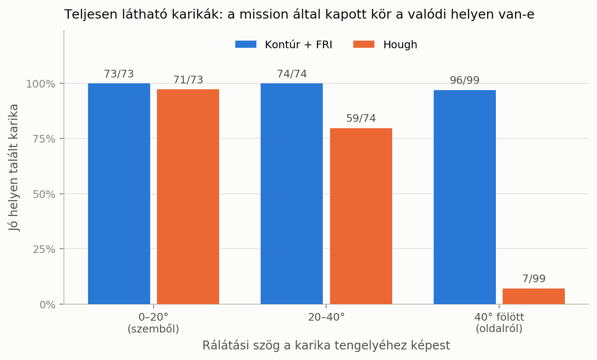
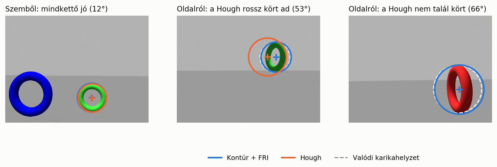

# Hough körkereső: átnézés és összehasonlítás a kontúr alapú detektorral

## Hogyan működik a `tello_camera_hough`

1. A képet szürkeárnyalatossá alakítja, és mediánszűrővel (5×5) zajt csökkent. A `resize` szorzója 1, tehát valójában nem kicsinyít.
2. `cv2.HoughCircles` (HOUGH_GRADIENT) a következő beállításokkal:
   - `dp=1.2`;
   - `minDist=50` px (két kör középpontja legalább ennyire van egymástól);
   - `param1=100` (az élkereső felső küszöbe);
   - `param2=40` (ennyi „szavazat” kell egy körhöz);
   - sugár 20–300 px.
3. **Színhozzárendelés:** minden talált kör mentén egy 0,3·r vastag gyűrűben megszámolja, mennyi pixel esik az egyes színmaszkokba, és a legnagyobb arányú szín lesz a kör színe.
4. **„Fuzzy” rész:**
   - jelenlét = talált körök száma / 3;
   - aktiváció = min(jelenlét, legjobb színarány), ami fuzzy ÉS művelet;
   - aktív, ha az aktiváció ≥ 0,25.
5. **Kimenet:** minden talált kört kiküld a `donut_detector/circles` topicra (x, y, r, szín, arány), ugyanabban a formában, mint a kontúr alapú. A mission ezek közül a célszínű, 20–500 px sugarú körök közül a legnagyobbat választja.

A két detektor tehát cserélhető: a mission mindkettővel működik, ugyanazokat a topicokat használják.

## Átnézés: mi működik és mi nem

| # | Megállapítás | Hatás |
|---|---|---|
| 1 | **A Hough csak kört keres.** Oldalról nézve a karika ellipszis, ilyenkor nem talál kört, vagy egy rosszat illeszt rá. | Nagy: 40° fölötti rálátásnál a karikák 7%-át találja meg jó helyen (lásd lent). |
| 2 | **A színt küszöb nélkül rendeli a körhöz.** Egy álkör, ami a karikának csak 19%-át fedi, ugyanúgy megkapja a karika színét. A mission a legnagyobbat választja, és ez gyakran az álkör. | Nagy: a teljesen látható karikák 27%-ánál rossz helyre kormányozná a drónt. |
| 3 | **A színmérő gyűrű nem illik a karika alakjához.** A 0,3·r vastag sáv a kör vonalára van rajzolva, a karika viszont a külső sugár 60%-a és 100%-a között van. A sáv fele így a háttérre esik, a jó karikák színaránya is csak 0,47 (medián). | Közepes: emiatt nehéz értelmes küszöböt adni a 2. ponthoz. |
| 4 | **A legnagyobb keresett sugár 300 px, a mission viszont épp 300 px-nél kezdi az átrepülést.** Az átrepülés így többnyire a „célt elvesztette, de közel volt” ágon indul. | Kicsi: működik, de esetlegesebb. |
| 5 | **A képből kilógó karikát nem találja meg**, mert a kör középpontjának a képen belül kell lennie. | Közepes: a képszélen levágott karikák fele kimarad (107/220). |
| 6 | **Minden talált kört kiküld, színenként nem választ.** A „jelenlét” az álkörökkel együtt számol. | Kicsi |
| 7 | **A megjelenítés kijelző nélkül az egész node-ot leállítja** (Qt `Aborted`, a `try` sem segít). Ez a kontúr alapúra is igaz, ha `visualize:=true`. | Kicsi (nálad mindig van kijelző) |
| 8 | Az `info` topicra Python-szótár szöveg megy, nem JSON. A HSV-átalakítás körönként újra lefut. A `resize` nem csinál semmit. | Apróság |

## Összehasonlító mérés

**Adathalmaz:** ugyanaz a 300 kép véletlen drónpozíciókból, ismert karikahelyzetekkel, mint a fuzzy mérésnél.

**Értékelés:** úgy mérjük, ahogy a mission használja a detektort: az adott színű, 20–500 px sugarú körök közül a legnagyobb. Ez akkor „jó helyen” van, ha a középpontja legfeljebb max(15 px; a karika sugarának 25%-a) távolságra van a valóditól.

### Felismerés a karika láthatósága szerint (képenként és színenként)

| Láthatóság | Kontúr + FRI | Hough |
|---|---|---|
| Teljesen látszik (246) | **243 jó**, 3 rossz helyen | 137 jó, 66 rossz helyen, 43 kimaradt |
| Részben, képszélen (220) | 114 jó, 91 rossz helyen, 15 kimaradt | 81 jó, 32 rossz helyen, 107 kimaradt |
| Nem látszik (434) | 3 téves találat | 0 téves találat |

- Részben látható karikánál mindkét módszer gyakran téved a középponttal, mert csak egy ív látszik.
- A kontúr alapú ilyenkor is ad egy irányt, és az ív felé fordulva a karika hamar teljesen látható lesz.
- A Hough ilyenkor inkább semmit nem lát, és a drón keresésbe kezd.

### A rálátási szög a döntő tényező

| Rálátás a karika tengelyéhez | Kontúr + FRI | Hough |
|---|---|---|
| 0–20° (szemből) | 73/73 | 71/73 |
| 20–40° | 74/74 | 59/74 |
| 40° fölött (oldalról) | 96/99 | **7/99** |

### Futásidő (egy kép, egy processzormag)

| Kontúr + FRI | Hough |
|---|---|
| 10,3 ms | 16,5 ms |

### Teljes misszió (szimuláció, párban, azonos terhelés mellett)

| Detektor | n | Sikeres | Misszió hossza (lépés) | Ebből keresés (lépés) | Valós idő | RMS hiba yaw közelítéskor (px) | Átrepülés indítása |
|---|---|---|---|---|---|---|---|
| Kontúr + FRI | 3 | 3/3 | 600 ± 18 | 71 ± 28 | 50–60 s | 16,0 ± 1,4 | 9/9 „elég közel” (r ≥ 300 px) |
| Hough | 3 | 3/3 | 4281 ± 2425 | 3444 ± 2039 | 110–286 s | 31,4 ± 0,7 | 9/9 „elvesztette, de közel volt” |

- **A Hough-gal is végigért mindhárom misszió, de átlagosan hétszer annyi lépésből**, és a lépések 80%-a keresés volt. A piros és a zöld karikát a drón az első után oldalról közelíti meg, és ilyenkor a Hough nem látja.
- **Közelítéskor a vízszintes hiba kétszer akkora** (31 px a 16 helyett), mert a Hough-kör középpontja kevésbé pontos.
- **Az átrepülés minden esetben a tartalék ágon indult**, mert a Hough legfeljebb 300 px-es kört keres, így a mission 300 px-es „elég közel” feltétele nem teljesült. Ez az átnézés 4. pontját igazolja.

A nyers naplók a `raw/missions` mappában vannak.

## Következtetés a dolgozathoz

- **A Hough-módszer működőképes alternatíva, de csak szemből.** A karikák kör alakját közvetlenül keresi, a színtől függetlenül, és szemből (0–20°) a karikák 97%-át jó helyen találja.
- **Oldalról nézve viszont használhatatlan:** a karika ellipszisnek látszik, a kör-transzformáció pedig erre nem illeszkedik. 40° fölött a karikák 7%-át találja meg.
- **A kontúr alapú detektor a szögtől szinte független** (96–100%), és gyorsabb is (10,3 ms a 16,5 ms-mal szemben). Ezért lett a rendszer fő detektora.
- **A dolgozat régi szövege ezzel ellentétes:** „éles szögben … a kontúr detektor pedig csak elveszti a kört”. A mérésben 85°-ig (szinte élről) is voltak teljesen látható karikák, és a javított kontúr alapú detektor ezek közül összesen háromszor tévedett (52°, 64° és 72°-nál). Hogy a régi megfigyelés honnan jött (a régi, hibás színszámításból vagy más helyzetből), az a mérésből nem derül ki.

## Ha a Hough-ot javítani szeretnéd

1. **Színküszöb:** a színarány minimum 0,3 legyen, és színenként csak a legjobb kör menjen tovább. Így a rossz helyre kormányzásból „nem lát semmit” lesz, ami a misszió szempontjából biztonságosabb.
2. **A színmérő gyűrűt a karika alakjához kell igazítani:** a 0,6·r és az r közötti sáv.
3. **A legnagyobb keresett sugarat 300 px fölé kell emelni**, hogy a közeli karikánál a mission „elég közel” ága induljon.
4. **Az ellipszis-probléma a Hough körkeresővel nem oldható meg.** Erre az ellipszisillesztés (`cv2.fitEllipse`) a jó megoldás a kontúrokon. Ez ráadásul a karika dőlésszögét is megadja, amivel a korábban felvetett „köríves ráállás” is megvalósítható lenne.

## Újrafuttatás

A mérés scriptjei a `scripts` mappában vannak, a konténerben futtathatók:
- `eval_detectors.py`: a két detektor kiértékelése az adathalmazon. Mindkét detektor valódi kódja fut, a Hough-nál maga a képfeldolgozó callback.
- `summarize.py`: összesítés.
- `plots.py`: az ábrák.
- `gt.py`: a valódi karikahelyzetek visszavetítése.

A [`detectors.json`](detectors.json) tartalmazza mindkét detektor eredményét mind a 300 képre, színenként. Az adathalmaz képei a `results/fuzzy/scripts/capture.py` scripttel, a 2026-os véletlenmaggal újragyárthatók.
