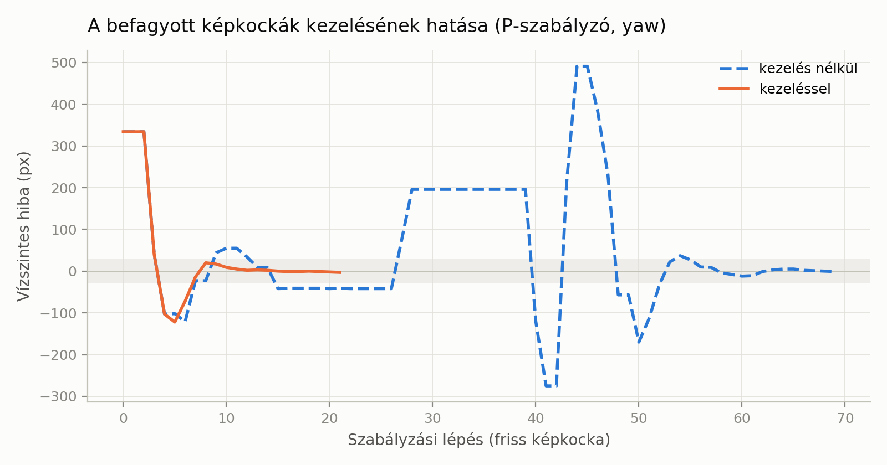
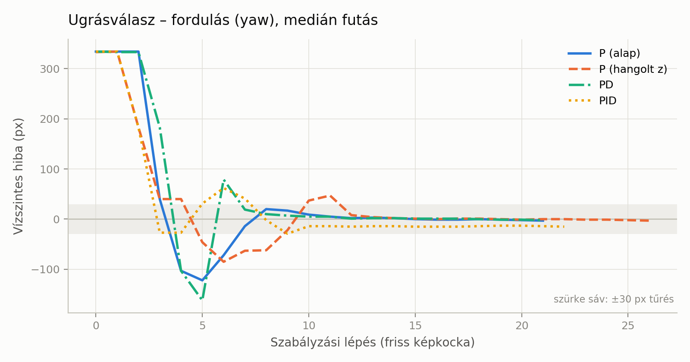
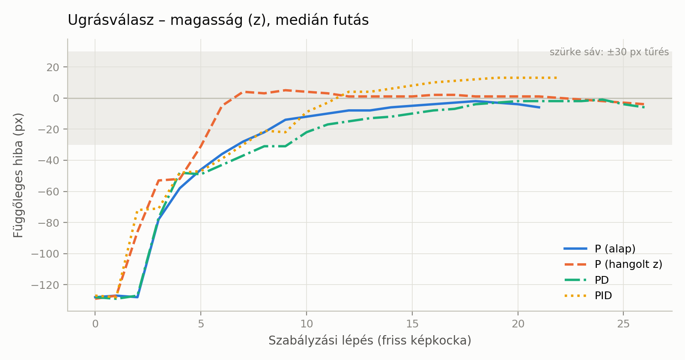

# P, PD és PID szabályzó összehasonlítása (szimuláció)

## A szabályzó

A `tello_mission` node a karika középpontjának a képközépponttól való eltéréséből (hiba, pixelben) számolja a fordulást (yaw) és a magasságváltozást (z). A szabályzó diszkrét PID ([`pid.py`](../../drone_ws/src/tello_mission/tello_mission/pid.py)), egy mintavétel = egy kamerakép:

    u(k) = Kp·e(k) + Ki·Σe(i) + Kd·D(k),   D(k) = α·(e(k) − e(k−1)) + (1 − α)·D(k−1)

- A D tag simított (α = 0,5), mert a detektált középpont képkockánként néhány pixelt ugrál.
- Az integrál korlátos (anti-windup, ±400 px·lépés).
- Az erősítések ROS paraméterek (`kp_yaw`, `ki_yaw`, `kd_yaw`, `kp_z`, `ki_z`, `kd_z`, `i_limit`).

## A mérés

- **Ugrásválasz:** a drón 0,3 rad-dal (≈17°) elfordítva és a kék karika alatt indul. Az első ráállást mérjük, amíg a karika a ±30 px-es tűrésen belülre nem kerül, és ott marad 10 friss képkockán át.
- **Teljes misszió:** kék → piros → zöld karika, az alap kezdőpozícióból.
- Minden futás elszigetelt Docker konténerben ment (Gazebo, CPU-s renderelés), 4 futás párhuzamosan, azonos terhelés mellett.
- A mintavétel a „szabályzási lépés”: egy friss képkockára adott parancs. A befagyott képkockák nem számítanak bele (lásd lent).

Mért jellemzők:
- **túllövés:** a legnagyobb ellentétes előjelű hiba, miután a hiba előjelet váltott;
- **beállás:** ennyi lépés után marad a hiba tartósan ±30 px-en belül;
- **ráállás:** lépések a közelítés indulásáig;
- **IAE:** a hiba abszolút értékének összege (integrated absolute error).

## Eredmények

### 1. A befagyott képkockák kezelése (a legnagyobb javulás)

A CPU-s renderelés miatt a kamerakép időnként késik vagy „befagy”: a detektor 5–12 képkockán át ugyanazt a karikát küldi, mert a kép még nem mutatja az előző parancs hatását. Kezelés nélkül a szabályzó minden ismételt képre újra beavatkozik, így vakon túlkormányoz (holtidő). A javítás: ha a mért karika pontosan megegyezik az előzővel, a mission nem ad ki parancsot, és a PID-et sem frissíti (`skip_stale_frames`, alapból bekapcsolva).

| Változat | n | Túllövés yaw (px) | Beállás yaw (lépés) | Ráállás (lépés) | IAE yaw (px·lépés) |
|---|---|---|---|---|---|
| P, kezelés nélkül | 3 | 357 ± 88 | 47,0 ± 29,8 | 57,0 ± 29,8 | 6802 ± 3830 |
| P, kezeléssel | 5 | 119 ± 97 | 9,8 ± 5,3 | 20,6 ± 4,6 | 1514 ± 604 |

*A „kezelés nélkül” mérés 3, a „kezeléssel” 4 párhuzamos szimuláció mellett futott, tehát a kezelés nélküli változatnak kisebb terhelés jutott. Ez ellene, nem mellette szól.*

### 2. Ugrásválasz (átlag ± szórás, n = 5)

| Változat | Túllövés yaw (px) | Túllövés z (px) | Beállás yaw (lépés) | Beállás z (lépés) | Ráállás (lépés) | IAE yaw | IAE z |
|---|---|---|---|---|---|---|---|
| P (alap: Kp,yaw = 0,0005, Kp,z = 0,0015) | 119 ± 97 | 0 ± 1 | 9,8 ± 5,3 | 7,4 ± 0,9 | 20,6 ± 4,6 | 1514 ± 604 | 725 ± 14 |
| P (hangolt z: Kp,z = 0,0024) | 141 ± 122 | 12 ± 18 | 12,2 ± 3,9 | 6,4 ± 2,1 | 22,2 ± 3,9 | 1647 ± 568 | 572 ± 147 |
| PD (Kd,yaw = 0,0004, Kd,z = 0,0012) | 114 ± 46 | 0 ± 0 | 11,4 ± 4,0 | 9,0 ± 1,9 | 21,4 ± 4,0 | 1617 ± 86 | 804 ± 20 |
| PID (+ Ki,yaw = 0,000025, Ki,z = 0,000075) | 72 ± 101 | 13 ± 2 | 9,6 ± 4,2 | 7,6 ± 0,5 | 20,4 ± 3,4 | 1389 ± 618 | 719 ± 94 |

### 3. Teljes misszió (átlag ± szórás, n = 3)

| Változat | Sikeres | Misszió hossza (lépés) | RMS hiba yaw közelítéskor (px) | RMS hiba z közelítéskor (px) | Befagyott képkocka |
|---|---|---|---|---|---|
| P (alap) | 3/3 | 561 ± 19 | 16,2 ± 1,9 | 9,2 ± 0,1 | 52 ± 3 |
| P (hangolt z) | 3/3 | 540 ± 8 | 15,3 ± 0,7 | **5,8 ± 0,2** | 47 ± 9 |
| PD | 3/3 | 562 ± 33 | 15,5 ± 0,5 | 9,3 ± 0,2 | 51 ± 21 |
| PID | 3/3 | 545 ± 24 | 15,6 ± 1,0 | 9,4 ± 0,4 | 40 ± 7 |

### Előzetes hangolási kör (ugrásválasz, n = 4, csak az első ráállás)

| Változat | Túllövés yaw (px) | IAE yaw | IAE z |
|---|---|---|---|
| P, Kp,yaw = 0,0008, Kp,z = 0,0024 | 197 | 2410 | 524 |
| PD, kis D (Kd,yaw = 0,00015, Kd,z = 0,0004) | 137 | 1785 | 762 |
| PD, nagyobb P + kis D (Kp,yaw = 0,0008, Kd,yaw = 0,0002) | 146 | 2122 | 525 |

A nagyobb yaw-erősítés minden esetben rontott, a nagyobb z-erősítés minden esetben javított.

## Következtetések

1. **A legnagyobb javulást nem a szabályzó típusa, hanem a holtidő kezelése hozta:** a túllövés harmadára, a ráállás ideje kb. harmadára csökkent.
2. **Fordulásra (yaw) a P, PD és PID között nincs a szórásnál nagyobb különbség.** A szimulációban a drónt teleportáljuk, ezért nincs tehetetlensége: a szakasz gyakorlatilag tiszta integrátor (egy lépés = egy elfordulás), amelyre a P-szabályzónak nincs maradó hibája. A D tag a megmaradó 1–2 lépésnyi késés mellett inkább lengést okozott (PD a medián futásban: −160 px), viszont a futások közötti szórást csökkentette (IAE yaw: 1617 ± 86 a P 1514 ± 604-ével szemben).
3. **Az I tag magasságban következetesen ~13 px túllövést okozott** (13 ± 2 px), a klasszikus integrátor-túllövést, javulás nélkül.
4. **Magasságban a nagyobb P-erősítés egyértelműen jobb:** közelítéskor az RMS hiba 9,2-ről 5,8 px-re csökkent, és ez minden futásban így volt (szórás 0,1–0,2 px).
5. **A választott alapbeállítás:** P-szabályzó, Kp,yaw = 0,0005, Kp,z = 0,0024, Ki = Kd = 0. A PID paraméterekkel bármikor bekapcsolható.
6. **Valódi drónon** (tehetetlenség, szél, akkumulátor-merülés) a D és az I tag hasznos lehet. Ezt valós repüléssel kellene ellenőrizni.

## Újrafuttatás

Egy futás a CSV naplóval, például PID-del:

    ros2 run tello_mission tello_mission --ros-args -p log_file:=/root/DockerFiles/results/run.csv -p kd_yaw:=0.0004 -p kd_z:=0.0012 -p ki_yaw:=0.000025 -p ki_z:=0.000075

Ugrásválaszhoz a drónt elfordítva kell betölteni:

    ros2 run gazebo_ros spawn_entity.py -file .../tello.urdf -entity tello_drone -Y 0.3

A táblázatok és a grafikonok a konténerben készülnek (ott van matplotlib):

    python3 results/pid/scripts/table.py results/pid
    python3 results/pid/scripts/plots.py results/pid

A nyers adatok a `raw/` mappában vannak:
- `raw/step`: ugrásválasz;
- `raw/step_without_stale_skip`: ugrásválasz befagyott képkocka-kezelés nélkül;
- `raw/mission`: teljes misszió.
